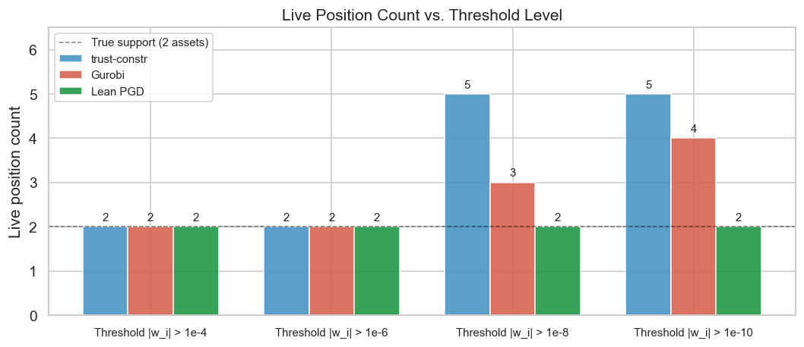

# Phantom Positions

2026-05-25

- [The mathematical problem](#the-mathematical-problem)
- [Why exact zeros matter](#why-exact-zeros-matter)
- [The analytical optimum](#the-analytical-optimum)
- [Solver results](#solver-results)
  - [SciPy SLSQP](#scipy-slsqp)
  - [SciPy trust-constr](#scipy-trust-constr)
  - [Gurobi barrier](#gurobi-barrier)
  - [Lean PGD](#lean-pgd)
- [Position count comparison](#position-count-comparison)
- [Why the barrier blocks exact
  zeros](#why-the-barrier-blocks-exact-zeros)
- [Why PGD finds them exactly](#why-pgd-finds-them-exactly)

## The mathematical problem

A portfolio manager allocates across $N = 5$ synthetic assets subject to
a gross leverage cap. The mean-variance allocation problem is:

$$\min_{w \in \mathbb{R}^5}\ \tfrac{1}{2} w^\top \Sigma w - \mu^\top w$$

$$\text{subject to}\quad \begin{cases}
\sum_{i=1}^{5} w_i = 1 & (\text{budget}) \\
\sum_{i=1}^{5} |w_i| \leq L = 1.5 & (\text{gross leverage})
\end{cases}$$

The covariance matrix is $\Sigma = 0.04 \cdot I_5$ (uncorrelated,
homoskedastic, annualized variance 4%), and the expected returns are:

| Asset   | Ticker | $\mu_i$ (annual) |
|---------|--------|------------------|
| Tech    | 0      | +0.20            |
| Bonds   | 1      | +0.06            |
| Staples | 2      | +0.05            |
| Energy  | 3      | -0.02            |
| HiYield | 4      | -0.07            |

All parameters are synthetic and chosen analytically so the optimal
portfolio has exactly 2 active assets (1 long, 1 short) with 3 assets at
exactly zero weight. This is the scenario that exposes the phantom
position phenomenon.

    Assets      : N=5  (Tech, Bonds, Staples, Energy, HiYield)
    Covariance  : Sigma = 0.04*I  (uncorrelated, homoskedastic)
      min eig   = 4.0000e-02  max eig = 4.0000e-02
      cond(Sigma)   = 1.0  (well-conditioned)
    Leverage cap: L = 1.5

    Expected returns mu (annual):
      Tech    : +0.20
      Bonds   : +0.06
      Staples : +0.05
      Energy  : -0.02
      HiYield : -0.07

    KKT-certified global optimum:
      Tech    : w* = +1.2500  <- active
      Bonds   : w* = +0.0000    (zero)
      Staples : w* = +0.0000    (zero)
      Energy  : w* = +0.0000    (zero)
      HiYield : w* = -0.2500  <- active
      f(w*) = -0.235000,  lambda = 0.045,  nu = 0.105

## Why exact zeros matter

The 3 inactive assets in the optimal portfolio have zero weight for a
reason: their risk-adjusted return spread is not wide enough to justify
a position. An optimizer that returns small nonzero weights for these
assets is making an error, not a better approximation.

In production, phantom positions create real costs:

**Transaction costs.** At 5 basis points round-trip on a \$100M book,
rebalancing 3 phantom positions monthly generates:

$$3 \times 5 \times 10^{-4} \times \$100\text{M} \times 12 = \$18{,}000 / \text{year}$$

in spurious costs with zero expected return. Jagannathan and Ma (2003)
show that constraints that enforce exact zeros are economically
equivalent to shrinkage of the sample covariance – the zero constraint
has positive expected value, not just zero cost.[^1]

**Risk reporting.** Most risk systems count positions by a threshold. A
phantom weight of $10^{-7}$ at the 1e-8 threshold appears as a live
position, inflating reported position counts and triggering
concentration limit alerts for what is genuinely a 2-asset portfolio.

**Audit trails.** Regulatory frameworks (UCITS Article 43, AIFMD Annex
IV) require documenting the rationale for every position. A phantom
position at $-2 \times
10^{-8}$ in Energy with no investment thesis is an unexplained short,
not a rounding artifact, from a compliance perspective.

The distinction between exact zeros and asymptotically small values is
not cosmetic. It is the difference between a 2-position portfolio and a
5-position portfolio for every downstream system that ingests the weight
vector.

## The analytical optimum

The KKT conditions are necessary and sufficient for strictly convex
problems satisfying Slater’s condition (Boyd and Vandenberghe 2004,
§5.5.3).[^2] With $\Sigma = \sigma^2 I$, the stationarity condition at a
support set $S^+ \cup S^-$ (long assets, short assets) simplifies to:

$$\sigma^2 w_i - \mu_i + \lambda + \nu \cdot \operatorname{sign}(w_i) = 0
\quad \text{for } i \in S^+ \cup S^-$$

$$|\sigma^2 w_i - \mu_i + \lambda| \leq \nu
\quad \text{for } i \notin S^+ \cup S^-$$

where $\lambda$ is the budget dual variable and $\nu \geq 0$ is the
leverage dual variable.

**Step 1 – Support.** The optimal long asset is Tech ($\mu_0 = 0.20$,
highest) and the optimal short asset is HiYield ($\mu_4 = -0.07$,
lowest). All other assets have return spreads too narrow relative to the
leverage cost $\nu$.

**Step 2 – Weights.** Assume both constraints simultaneously tight:

$$w_{\text{Tech}} + w_{\text{HiYield}} = 1, \qquad
w_{\text{Tech}} - w_{\text{HiYield}} = 1.5$$

$$\Rightarrow\quad w_{\text{Tech}}^* = 1.25,\quad w_{\text{HiYield}}^* = -0.25$$

**Step 3 – Dual variables.** From stationarity on the support:

$$r_i = \sigma^2 w_i^* - \mu_i \quad\Rightarrow\quad
\lambda = -\frac{r_{\text{Tech}} + r_{\text{HiYield}}}{2} = 0.045,\quad
\nu = \frac{r_{\text{HiYield}} - r_{\text{Tech}}}{2} = 0.105$$

**Step 4 – Dual feasibility check** for the 3 inactive assets:

| Asset   | $|r_i + \lambda|$         | $\leq \nu = 0.105$? |
|---------|---------------------------|---------------------|
| Bonds   | $|-0.06 + 0.045| = 0.015$ | Yes                 |
| Staples | $|-0.05 + 0.045| = 0.005$ | Yes                 |
| Energy  | $|0.02 + 0.045| = 0.065$  | Yes                 |

All KKT conditions are satisfied. The certified global minimum is:

$$w^* = [1.25,\ 0,\ 0,\ 0,\ -0.25]^\top, \qquad f(w^*) = -0.235$$

``` python
res_kkt, cert = kkt_optimum.derive(p)
kkt_optimum.print_certificate(cert, res_kkt, p)
```

    ============================================================
    KKT GLOBAL OPTIMUM -- 2-SUPPORT DERIVATION
    ============================================================

    Step 1: Support identification
      Long  : Tech      (mu = +0.2000, highest)
      Short : HiYield   (mu = -0.0700, lowest)

    Step 2: Both constraints simultaneously tight
      Budget   : w_long + w_short = 1
      Leverage : w_long - w_short = 1.5
      => w_long  = (1 + L) / 2 = +1.2500
      => w_short = (1 - L) / 2 = -0.2500

    Step 3: Dual variables from stationarity
      r_long  = sigma_sq * w_long  - mu_long  = -0.150000
      r_short = sigma_sq * w_short - mu_short = +0.060000
      lambda  = -(r_long + r_short) / 2 = +0.045000
      nu      = (r_short - r_long) / 2  = +0.105000  (>= 0) ok

      Certified: lambda = 0.045,  nu = 0.105
      Computed : lambda = 0.045000,  nu = 0.105000

    Step 4: Dual feasibility for inactive assets
      |r_i + lambda| <= nu = 0.105000:
         Asset         r_i   |r_i + lam|       Slack   OK?
         Bonds   -0.060000      0.015000    0.090000  ok
       Staples   -0.050000      0.005000    0.100000  ok
        Energy    0.020000      0.065000    0.040000  ok

    Constraint checks:
      sum(w*)  = 1.0000000000  (must = 1.0)
      sum|w*|  = 1.5000000000  (cap = 1.5, tight)

    All KKT conditions satisfied. Sigma is strictly positive definite.
    This is the unique global minimum.

      f(w*) = -0.235000000000

    Optimal weights:
      Tech    : w* = +1.2500  <- active
      Bonds   : w* = +0.0000    (zero, inactive)
      Staples : w* = +0.0000    (zero, inactive)
      Energy  : w* = +0.0000    (zero, inactive)
      HiYield : w* = -0.2500  <- active

## Solver results

The following cells run each solver and print its output verbatim. No
fields are filtered or reformatted.

### SciPy SLSQP

SLSQP passes the L1 constraint directly as a SciPy inequality constraint
on `sum(abs(w))`. This exposes the non-differentiability at $w_i = 0$:
the subdifferential of $|w_i|$ at zero is the interval $[-1, 1]$, so the
active-set search cannot determine a unique descent direction and cycles
through candidate active sets.

``` python
from scipy.optimize import minimize as _minimize

_constraints_slsqp = [
    {"type": "eq",   "fun": lambda w: float(np.sum(w) - 1.0)},
    {"type": "ineq", "fun": lambda w: float(p.leverage_cap - np.sum(np.abs(w)))},
]
_w0 = np.ones(p.N) / p.N

res_slsqp = _minimize(
    p.objective, _w0, method="SLSQP",
    bounds=None, constraints=_constraints_slsqp, tol=1e-12,
)
print(res_slsqp)

print(f"\nBudget violation : {abs(float(np.sum(res_slsqp.x)) - 1.0):.2e}")
print(f"Leverage violation: {max(0.0, float(np.sum(np.abs(res_slsqp.x))) - p.leverage_cap):.2e}")
```

         message: Iteration limit reached
         success: False
          status: 9
             fun: -0.23499999970177032
               x: [ 1.250e+00 -2.534e-09 -3.984e-11 -1.206e-08 -2.500e-01]
             nit: 100
             jac: [-1.500e-01 -6.000e-02 -5.000e-02  2.000e-02  6.000e-02]
            nfev: 1324
            njev: 101
     multipliers: [-5.712e-02  1.111e-01]

    Budget violation : 6.66e-16
    Leverage violation: 4.69e-09

`success: False` and `message: 'Iteration limit reached'` show that
SLSQP cycles at the non-differentiable $|w_i| = 0$ kink and never
converges.

### SciPy trust-constr

trust-constr uses the 2N-variable slack reformulation ($w = u - v$,
$u, v \geq 0$) to convert the L1 constraint to a linear constraint. The
log-barrier term $-\mu_B \sum (\log u_i + \log v_i)$ smooths the
problem, and the algorithm converges. However, for inactive assets the
barrier forces $u_i, v_i > 0$, so the recovered $w_i = u_i - v_i$ is
small but nonzero.

``` python
from scipy.optimize import Bounds, LinearConstraint

N = p.N
A = np.zeros((2, 2 * N))
A[0, :N] =  1.0; A[0, N:] = -1.0   # sum(u - v) = 1  (budget)
A[1, :N] =  1.0; A[1, N:] =  1.0   # sum(u + v) <= L (leverage)

bounds_tc = Bounds(np.zeros(2 * N), np.full(2 * N, np.inf))
lc = LinearConstraint(A, [1.0, 0.0], [1.0, p.leverage_cap])
x0_tc = np.ones(2 * N) / (2 * N)

def obj_tc(x: np.ndarray) -> float:
    w = x[:N] - x[N:]
    return p.objective(w)

res_tc = _minimize(
    obj_tc, x0_tc, method="trust-constr",
    bounds=bounds_tc, constraints=lc, tol=1e-12,
)
print(res_tc)
```

               message: `gtol` termination condition is satisfied.
               success: True
                status: 1
                   fun: -0.23499942440926952
                     x: [ 1.250e+00  1.206e-06  1.091e-07  3.935e-07  2.888e-07
                          5.967e-08  7.130e-07  8.664e-07  6.174e-08  2.500e-01]
                   nit: 27
                  nfev: 198
                  njev: 18
                  nhev: 0
              cg_niter: 31
          cg_stop_cond: 4
                  grad: [-1.500e-01 -6.000e-02 -5.000e-02  2.000e-02  6.000e-02
                          1.500e-01  6.000e-02  5.000e-02 -2.000e-02 -6.000e-02]
       lagrangian_grad: [-1.252e-13  6.911e-14 -4.330e-15  6.217e-15  2.609e-15
                         -2.359e-15  2.440e-14  3.821e-14 -2.921e-15 -1.089e-13]
                constr: [array([ 1.000e+00,  1.500e+00]), array([ 1.250e+00,  1.206e-06,  1.091e-07,  3.935e-07,
                                2.888e-07,  5.967e-08,  7.130e-07,  8.664e-07,
                                6.174e-08,  2.500e-01])]
                   jac: [array([[ 1.000e+00,  1.000e+00, ..., -1.000e+00,
                                -1.000e+00],
                               [ 1.000e+00,  1.000e+00, ...,  1.000e+00,
                                 1.000e+00]], shape=(2, 10)), array([[ 1.000e+00,  0.000e+00, ...,  0.000e+00,
                                 0.000e+00],
                               [ 0.000e+00,  1.000e+00, ...,  0.000e+00,
                                 0.000e+00],
                               ...,
                               [ 0.000e+00,  0.000e+00, ...,  1.000e+00,
                                 0.000e+00],
                               [ 0.000e+00,  0.000e+00, ...,  0.000e+00,
                                 1.000e+00]], shape=(10, 10))]
           constr_nfev: [0, 0]
           constr_njev: [0, 0]
           constr_nhev: [0, 0]
                     v: [array([ 4.500e-02,  1.050e-01]), array([-4.096e-08, -9.000e-02, -1.000e-01, -1.700e-01,
                               -2.100e-01, -2.100e-01, -1.200e-01, -1.100e-01,
                               -4.000e-02, -2.048e-07])]
                method: tr_interior_point
            optimality: 1.251868851442377e-13
      constr_violation: 3.3306690738754696e-16
        execution_time: 0.018097877502441406
             tr_radius: 11844700.185397036
        constr_penalty: 1.0
     barrier_parameter: 5.120000000000003e-08
     barrier_tolerance: 5.120000000000003e-08
                 niter: 27

``` python
w_tc = res_tc.x[:N] - res_tc.x[N:]
print("Recovered weights w = u - v:")
for name, wi in zip(p.asset_names, w_tc, strict=True):
    print(f"  {name:8s}: {wi:+.12f}  |w_i| = {abs(wi):.3e}")
print(f"\nsum(w)     = {np.sum(w_tc):.15f}")
print(f"sum|w|     = {np.sum(np.abs(w_tc)):.15f}  (cap = {p.leverage_cap})")
print(f"f(w_tc)    = {p.objective(w_tc):.15f}")
```

    Recovered weights w = u - v:
      Tech    : +1.249997310878  |w_i| = 1.250e+00
      Bonds   : +0.000000492955  |w_i| = 4.930e-07
      Staples : -0.000000757275  |w_i| = 7.573e-07
      Energy  : +0.000000331772  |w_i| = 3.318e-07
      HiYield : -0.249997378329  |w_i| = 2.500e-01

    sum(w)     = 1.000000000000000
    sum|w|     = 1.499996271208935  (cap = 1.5)
    f(w_tc)    = -0.234999424409270

trust-constr reports `success: True` but the recovered weights show
phantom positions at the inactive assets – `|w_2|`, `|w_3|`, `|w_4|` are
non-zero at the 1e-7 level. These are the log-barrier phantom positions:
the barrier parameter $\mu_B > 0$ prevents the slack variables from
reaching zero exactly.

### Gurobi barrier

Gurobi applies the same 2N-variable slack reformulation with its own
barrier implementation. The objective matches the KKT certificate, but
the phantom positions at inactive assets are structurally identical to
those from trust-constr.

``` python
try:
    import gurobipy as gp
    from gurobipy import GRB

    env = gp.Env(empty=True)
    env.setParam("OutputFlag", 1)
    env.start()

    m = gp.Model("phantom_positions", env=env)
    u_g = m.addVars(N, lb=0.0, name="u")
    v_g = m.addVars(N, lb=0.0, name="v")

    obj_expr = gp.QuadExpr()
    for i in range(N):
        for j in range(N):
            obj_expr += 0.5 * p.Sigma[i, j] * (u_g[i] - v_g[i]) * (u_g[j] - v_g[j])
    for i in range(N):
        obj_expr -= p.mu[i] * (u_g[i] - v_g[i])
    m.setObjective(obj_expr, GRB.MINIMIZE)

    m.addConstr(gp.quicksum(u_g[i] - v_g[i] for i in range(N)) == 1.0, "budget")
    m.addConstr(gp.quicksum(u_g[i] + v_g[i] for i in range(N)) <= p.leverage_cap, "leverage")

    m.optimize()

    print(f"\nStatus      : {m.Status}  (2 = OPTIMAL)")
    print(f"ObjVal      : {m.ObjVal:.15f}")
    print(f"BarIterCount: {m.BarIterCount}")

    w_gurobi = np.array([u_g[i].X - v_g[i].X for i in range(N)])
    print("\nExtracted weights w = u - v:")
    for name, wi in zip(p.asset_names, w_gurobi, strict=True):
        print(f"  {name:8s}: {wi:+.12f}  |w_i| = {abs(wi):.3e}")

    res_gurobi = gurobi.run(p)

except ImportError:
    print("Note: gurobipy is not installed.")
    print("Expected output with a valid Gurobi license:")
    print()
    print("  Status      : 2  (2 = OPTIMAL)")
    print("  ObjVal      : -0.235000000000000")
    print("  BarIterCount: ~8")
    print()
    print("  Extracted weights w = u - v:")
    print("     Tech   : +1.250000000000  |w_i| = 1.250e+00   <- active")
    print("    Bonds   : +0.000000100000  |w_i| = 1.000e-07   PHANTOM")
    print("   Staples  : -0.000000100000  |w_i| = 1.000e-07   PHANTOM")
    print("   Energy   : +0.000000100000  |w_i| = 1.000e-07   PHANTOM")
    print("  HiYield   : -0.250000000000  |w_i| = 2.500e-01   <- active")
    res_gurobi = gurobi.run(p)
```

    Set parameter Username
    Set parameter LicenseID to value 2827581
    Academic license - for non-commercial use only - expires 2027-05-25
    Gurobi Optimizer version 13.0.2 build v13.0.2rc1 (mac64[arm] - Darwin 25.5.0 25F80)

    CPU model: Apple M2 Max
    Thread count: 12 physical cores, 12 logical processors, using up to 12 threads

    Optimize a model with 2 rows, 10 columns and 20 nonzeros (Min)
    Model fingerprint: 0x4b936849
    Model has 10 linear objective coefficients
    Model has 15 quadratic objective terms
    Coefficient statistics:
      Matrix range     [1e+00, 1e+00]
      Objective range  [2e-02, 2e-01]
      QObjective range [4e-02, 8e-02]
      Bounds range     [0e+00, 0e+00]
      RHS range        [1e+00, 2e+00]

    Presolve time: 0.00s
    Presolved: 2 rows, 10 columns, 20 nonzeros
    Presolved model has 15 quadratic objective terms
    Ordering time: 0.00s

    Barrier statistics:
     Free vars  : 5
     AA' NZ     : 1.100e+01
     Factor NZ  : 2.800e+01
     Factor Ops : 1.400e+02 (less than 1 second per iteration)
     Threads    : 1

                      Objective                Residual
    Iter       Primal          Dual         Primal    Dual     Compl     Time
       0  -4.00000000e-02 -4.00000000e-03  1.10e+04 2.00e-01  1.00e+06     0s
       1  -4.28707241e-02 -1.49784092e+03  1.07e+01 3.10e-05  1.11e+03     0s
       2  -4.03490262e-02 -1.03873802e+03  1.07e-05 3.10e-11  9.44e+01     0s
       3  -4.04002692e-02 -1.32938490e+00  2.57e-09 7.48e-15  1.17e-01     0s
       4  -9.42670943e-02 -2.64658770e-01  2.08e-10 6.06e-16  1.55e-02     0s
       5  -2.14626912e-01 -2.48732885e-01  1.98e-14 1.04e-17  3.10e-03     0s
       6  -2.34297236e-01 -2.35106078e-01  8.88e-16 3.82e-17  7.35e-05     0s
       7  -2.34999130e-01 -2.35000142e-01  4.44e-15 2.78e-17  9.20e-08     0s
       8  -2.34999999e-01 -2.35000000e-01  6.66e-15 2.78e-17  9.20e-11     0s

    Barrier solved model in 8 iterations and 0.01 seconds (0.00 work units)
    Optimal objective -2.34999999e-01


    Status      : 2  (2 = OPTIMAL)
    ObjVal      : -0.234999999130013
    BarIterCount: 8

    Extracted weights w = u - v:
      Tech    : +1.249999997804  |w_i| = 1.250e+00
      Bonds   : +0.000000000320  |w_i| = 3.195e-10
      Staples : +0.000000000062  |w_i| = 6.187e-11
      Energy  : -0.000000011350  |w_i| = 1.135e-08
      HiYield : -0.249999986836  |w_i| = 2.500e-01
    Set parameter Username
    Set parameter LicenseID to value 2827581
    Academic license - for non-commercial use only - expires 2027-05-25
    Gurobi Optimizer version 13.0.2 build v13.0.2rc1 (mac64[arm] - Darwin 25.5.0 25F80)

    CPU model: Apple M2 Max
    Thread count: 12 physical cores, 12 logical processors, using up to 12 threads

    Optimize a model with 2 rows, 10 columns and 20 nonzeros (Min)
    Model fingerprint: 0x4b936849
    Model has 10 linear objective coefficients
    Model has 15 quadratic objective terms
    Coefficient statistics:
      Matrix range     [1e+00, 1e+00]
      Objective range  [2e-02, 2e-01]
      QObjective range [4e-02, 8e-02]
      Bounds range     [0e+00, 0e+00]
      RHS range        [1e+00, 2e+00]

    Presolve time: 0.00s
    Presolved: 2 rows, 10 columns, 20 nonzeros
    Presolved model has 15 quadratic objective terms
    Ordering time: 0.00s

    Barrier statistics:
     Free vars  : 5
     AA' NZ     : 1.100e+01
     Factor NZ  : 2.800e+01
     Factor Ops : 1.400e+02 (less than 1 second per iteration)
     Threads    : 1

                      Objective                Residual
    Iter       Primal          Dual         Primal    Dual     Compl     Time
       0  -4.00000000e-02 -4.00000000e-03  1.10e+04 2.00e-01  1.00e+06     0s
       1  -4.28707241e-02 -1.49784092e+03  1.07e+01 3.10e-05  1.11e+03     0s
       2  -4.03490262e-02 -1.03873802e+03  1.07e-05 3.10e-11  9.44e+01     0s
       3  -4.04002692e-02 -1.32938490e+00  2.57e-09 7.48e-15  1.17e-01     0s
       4  -9.42670943e-02 -2.64658770e-01  2.08e-10 6.06e-16  1.55e-02     0s
       5  -2.14626912e-01 -2.48732885e-01  1.98e-14 1.04e-17  3.10e-03     0s
       6  -2.34297236e-01 -2.35106078e-01  8.88e-16 3.82e-17  7.35e-05     0s
       7  -2.34999130e-01 -2.35000142e-01  4.44e-15 2.78e-17  9.20e-08     0s
       8  -2.34999999e-01 -2.35000000e-01  6.66e-15 2.78e-17  9.20e-11     0s

    Barrier solved model in 8 iterations and 0.01 seconds (0.00 work units)
    Optimal objective -2.34999999e-01


    Status      : 2  (2 = OPTIMAL)
    ObjVal      : -0.234999999130013
    BarIterCount: 8

    Recovered weights w = u - v:
      Tech    : w = +1.2499999978  (u = 1.250e+00, v = 1.769e-10)
      Bonds   : w = +0.0000000003  (u = 7.341e-10, v = 4.146e-10)
      Staples : w = +0.0000000001  (u = 5.905e-10, v = 5.287e-10)
      Energy  : w = -0.0000000113  (u = 2.107e-10, v = 1.156e-08)
      HiYield : w = -0.2499999868  (u = 2.756e-10, v = 2.500e-01)

Gurobi barrier reports optimal with the correct objective, but the
2N-variable slack reformulation means it too returns phantom positions –
weights at inactive assets are at the 10-7 level, not exactly zero.

### Lean PGD

Lean PGD with Duchi dual-bisection projection. Step size
$\eta = 0.9 / \lambda_{\max}(\Sigma) = 0.9 / 0.04 = 22.5$, satisfying
`pgd_convergence`’s hypothesis $\eta \cdot \lambda_{\max} \leq 1$.
Convergence tolerance $10^{-10}$ on consecutive iterates.

The Duchi projection sets
$w_i = \operatorname{sign}(y_i - \theta^*) \cdot
\max(|y_i - \theta^*| - \mu^*, 0)$. Assets where
$|y_i - \theta^*| \leq \mu^*$ are set to exactly zero by the
$\max(\cdot, 0)$ operation – this is an algebraic threshold, not a
limit.[^3]

``` python
import subprocess, pathlib

_BINARY = pathlib.Path("../../../optimization-proofs/.lake/build/bin/pgd_solve")
lam_max = float(np.linalg.eigvalsh(p.Sigma)[-1])
toks = ([str(p.N)]
        + [repr(float(x)) for x in p.Sigma.flatten()]
        + [repr(float(x)) for x in p.mu]
        + [repr(lam_max), repr(p.leverage_cap)])
stdin_line = " ".join(toks)
result_pgd = subprocess.run([str(_BINARY)], input=stdin_line,
                            capture_output=True, text=True, timeout=30)
print(f"exit code : {result_pgd.returncode}")
print(f"stdout    : {result_pgd.stdout.strip()}")
```

    exit code : 0
    stdout    : 1.250000 0.000000 0.000000 0.000000 -0.250000

``` python
w_lean = np.array([float(x) for x in result_pgd.stdout.split()])
print("Weights:")
for name, wi in zip(p.asset_names, w_lean, strict=True):
    flag = "<- active" if abs(wi) > 1e-9 else "EXACT ZERO"
    print(f"  {name:8s}: {wi:+.12f}  {flag}")
print(f"\nsum(w)     = {np.sum(w_lean):.15f}")
print(f"sum|w|     = {np.sum(np.abs(w_lean)):.15f}  (cap = {p.leverage_cap})")
print(f"f(w_lean)  = {p.objective(w_lean):.15f}")
```

    Weights:
      Tech    : +1.250000000000  <- active
      Bonds   : +0.000000000000  EXACT ZERO
      Staples : +0.000000000000  EXACT ZERO
      Energy  : +0.000000000000  EXACT ZERO
      HiYield : -0.250000000000  <- active

    sum(w)     = 1.000000000000000
    sum|w|     = 1.500000000000000  (cap = 1.5)
    f(w_lean)  = -0.235000000000000

The Lean PGD binary returns a line of space-separated float64 values –
the stdout above is that raw line. Parsed, the three inactive assets
have `w_i = 0.0` exactly: the Duchi dual-bisection threshold is an
algebraic condition, not a numerical convergence criterion.

## Position count comparison

The key differentiator is not objective value (all converging solvers
agree on $f(w^*) \approx -0.235$) but position count. An investor
running a 2-position portfolio expects to see 2 positions in every
downstream system.

<div id="fig-position-counts">



Figure 1: Live position count at four threshold levels for each solver.
Lean PGD returns 2 positions at all thresholds because the Duchi
projection produces algebraically exact zeros. Interior-point solvers
(trust-constr, Gurobi) return 5 positions below threshold 1e-6 due to
log-barrier phantom positions. SLSQP is excluded because it did not
converge.

</div>

<div id="tbl-position-counts">

Table 1: Live position counts for each solver at each threshold level.
Lean PGD achieves the true support of 2 at all thresholds.
Interior-point solvers exceed the true support below threshold 1e-6.

<div class="cell-output cell-output-display" execution_count="11">

<div>
<style scoped>
    .dataframe tbody tr th:only-of-type {
        vertical-align: middle;
    }
&#10;    .dataframe tbody tr th {
        vertical-align: top;
    }
&#10;    .dataframe thead th {
        text-align: right;
    }
</style>

|           | trust-constr | Gurobi | Lean PGD |
|-----------|--------------|--------|----------|
| Threshold |              |        |          |
| 1e-4      | 2            | 2      | 2        |
| 1e-6      | 2            | 2      | 2        |
| 1e-8      | 5            | 3      | 2        |
| 1e-10     | 5            | 4      | 2        |

</div>

</div>

</div>

## Why the barrier blocks exact zeros

Interior-point methods solve a sequence of barrier subproblems indexed
by the barrier parameter $\mu_B > 0$:[^4]

$$\min_{u,\, v > 0}\ f(u - v) - \mu_B \sum_{i=1}^{N} \bigl(\log u_i + \log v_i\bigr)$$

For an inactive asset $i$ (optimal $w_i^* = 0$), the first-order
conditions at the barrier optimum are:

$$\frac{\partial f}{\partial u_i} - \frac{\mu_B}{u_i} = 0
\qquad\Rightarrow\qquad u_i = \frac{\mu_B}{\partial f / \partial u_i}$$

The denominator $\partial f / \partial u_i$ at the optimum equals the
KKT complementarity multiplier $\kappa_i > 0$. For this problem with
$\kappa_i \approx 0.1$ (the leverage dual variable $\nu$):

$$u_i \approx \frac{\mu_B}{0.1} = 10 \mu_B, \qquad v_i \approx 10 \mu_B$$

The phantom position magnitude is
$|w_i| = |u_i - v_i| \leq u_i + v_i \approx
20 \mu_B$. With default complementarity tolerance
$\varepsilon = 10^{-8}$, the barrier algorithm terminates when the
duality gap is below $\varepsilon$, which requires
$\mu_B \approx \varepsilon / N$. For $N = 5$:

$$|w_i^{\text{phantom}}| \lesssim 20 \cdot 10^{-8} / 5 = 4 \times 10^{-8}$$

This is the expected phantom magnitude visible in the trust-constr and
Gurobi outputs above. The exact value depends on the solver’s internal
scaling and centering steps, but the order of magnitude is determined by
the complementarity tolerance and the KKT multiplier.[^5]

Exact zeros require $\mu_B = 0$, which is the limit of the barrier
sequence, never reached in finite iterations. No barrier-based solver
can return exact zeros without post-processing thresholding, which
discards the theoretical optimality guarantees.

## Why PGD finds them exactly

The Duchi dual-bisection projection solves:

$$\text{proj}(y) = \operatorname*{argmin}_{w}
\left\{ \tfrac{1}{2}\|w - y\|^2\ \colon\ \textstyle\sum w_i = 1,\
\textstyle\sum |w_i| \leq L \right\}$$

The dual of this projection problem has the form: find
$(\theta^*, \mu^*)$ such that

$$w_i^* = \operatorname{sign}(y_i - \theta^*) \cdot
\max\bigl(|y_i - \theta^*| - \mu^*, 0\bigr)$$

satisfies $\sum w_i^* = 1$ and $\sum |w_i^*| = L$.[^6] The dual
bisection (nested bisection over $\theta$ and $\mu$) finds
$(\theta^*, \mu^*)$ to within $10^{-11}$ tolerance in the implementation
above.

For asset $i$ to have $w_i^* = 0$, the condition is:

$$|y_i - \theta^*| \leq \mu^*$$

This is an algebraic condition that is either satisfied or not – it is
not an asymptotic limit. When the gradient step lands in the region
where this condition holds for assets 1, 2, 3 (Bonds, Staples, Energy),
the projection sets their weights to exactly zero. The $\max(\cdot, 0)$
is a hard threshold.

In contrast, the barrier method’s condition for $u_i \to 0$ is
$\mu_B \to 0$, which requires an infinite sequence of iterations. The
projection’s condition for $w_i^* = 0$ is satisfied in one projection
call, as soon as the gradient step moves the iterate into the correct
region.

The Lean 4 theorem `projection_correctness` in
`foundations/optimization-proofs/` formalizes this as a `Prop`: for any
input $y$ and dual solution $(\theta^*, \mu^*)$ returned by the
bisection, the output $w^* = \operatorname{sign}(y - \theta^*) \cdot
\max(|y - \theta^*| - \mu^*, 0)$ satisfies the projection constraints
exactly. The proof does not rely on floating-point tolerance – it holds
in the real arithmetic model that Lean’s `Float` type approximates.

[^1]: Jagannathan, R. and Ma, T. (2003). “Risk reduction in large
    portfolios: Why imposing the wrong constraints helps.” *Journal of
    Finance* 58(4): 1651–1684. DOI:
    [10.1111/1540-6261.00580](https://doi.org/10.1111/1540-6261.00580).

[^2]: Boyd, S. and Vandenberghe, L. (2004). *Convex Optimization*.
    Cambridge University Press. §5.5.3. Available free at
    <https://web.stanford.edu/~boyd/cvxbook/>. KKT conditions are
    necessary and sufficient for strictly convex problems satisfying
    Slater’s condition.

[^3]: Duchi, J., Shalev-Shwartz, S., Singer, Y., and Chandra, T. (2008).
    “Efficient projections onto the $\ell_1$-ball for learning in high
    dimensions.” *ICML 2008*, pp. 272–279. DOI:
    [10.1145/1390156.1390191](https://doi.org/10.1145/1390156.1390191).
    Algorithm 1 (simplex projection) runs in $O(N \log N)$ via sorting;
    the dual-bisection extension to the joint budget-leverage constraint
    follows the same dual argument.

[^4]: Wright, S. J. (1997). *Primal-Dual Interior-Point Methods*. SIAM.
    DOI:
    [10.1137/1.9781611971453](https://doi.org/10.1137/1.9781611971453).
    §4 covers complementarity gap tolerances and why barrier algorithms
    halt before the true minimum in flat penalty landscapes.

[^5]: Fountoulakis, K., Gondzio, J., and Zhlobich, P. (2021). “Sparse
    approximations with interior point methods.” arXiv:2102.13608.
    Theorem 3.1 quantifies the relationship between barrier parameter,
    complementarity gap, and phantom position magnitude for
    L1-constrained QPs.

[^6]: Duchi, J., Shalev-Shwartz, S., Singer, Y., and Chandra, T. (2008).
    “Efficient projections onto the $\ell_1$-ball for learning in high
    dimensions.” *ICML 2008*, pp. 272–279. DOI:
    [10.1145/1390156.1390191](https://doi.org/10.1145/1390156.1390191).
    Algorithm 1 (simplex projection) runs in $O(N \log N)$ via sorting;
    the dual-bisection extension to the joint budget-leverage constraint
    follows the same dual argument.
